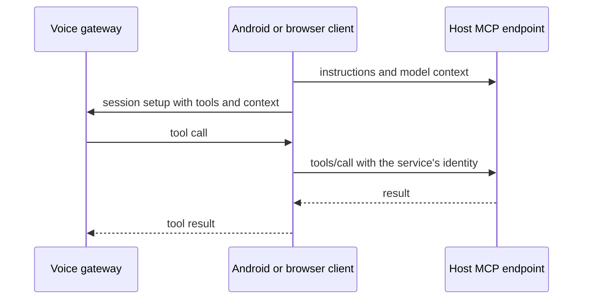

# Architecture

Go Mode separates the native shell, the host application, and the voice gateway. Each has one owner for its data and behavior.

| Component                   | Owns                                                                                                               |
| --------------------------- | ------------------------------------------------------------------------------------------------------------------ |
| Host                        | Accounts, authorization, frontend, product APIs, MCP tools and resources                                           |
| Android shell               | Service bootstrap, WebViews, microphone, audio routing, native voice, Telecom calls, settings, notifications, Halo |
| Browser integration         | Host-mode detection, browser MCP client, voice controls, notification integration                                  |
| Voice gateway               | Signaling, media, conversation turns, backend transport, local model orchestration                                 |
| Shared Go packages and SDKs | Discovery, OAuth and MCP transports, typed protocol contracts                                                      |

## Bootstrap and native access

The shell loads the frontend and fetches `/.well-known/gomode.json` outside the WebView’s critical path. It checks discovery and bridge versions before enabling native features.

An unavailable or incompatible manifest does not turn a hosted page into a compatible service. Native features remain disabled with a visible status. Authentication remains the host’s responsibility.

Each saved service keeps its own WebView, credentials, and MCP connection. Visited pages stay loaded when you switch services; only the selected page is on screen. Hidden pages stay signed in, mute their audio, and stop camera and microphone capture.

After a confirmed login signal and frontend preparation, native MCP and voice requests use that service’s identity. Leaving the trusted origin, reloading the page, or changing identity stops native access until the host validates it again.

## Voice tool flow

1. The client discovers each service’s tool group and the gateway of the service that starts voice.
2. It reads the active service’s MCP instructions and model context resources.
3. It starts a voice or text session with the gateway.
4. The gateway requests a tool call.
5. The client executes it through the owning host’s MCP endpoint or frontend and returns the result.

Native voice exposes the active service through three catalog tools: `discover_service`, `dispatch_service_tool`, and `read_service_resource`. A call targets the active service; an optional `server_id` must name it, so a call prepared before a switch fails instead of reaching the new service. The client validates the arguments against the tool’s schema before execution. Hidden services keep monitoring, and their alerts still reach the conversation.

The gateway does not call the host’s MCP endpoint itself and does not own service-item state. The host authorizes each action.

## Package boundaries

The root Go package is small: discovery and voice-token contracts. Heavy media and model dependencies stay under `voicegateway`. A host that only needs discovery does not import the entire voice stack.

The Android shell has no caic task SDK dependency or hard-coded task route. caic’s task list, details, diffs, and widgets stay in its hosted web frontend. Other hosts can expose different products through the same shell.

The [Go package documentation](https://pkg.go.dev/github.com/gomodedev/gomode) states the dependency rules. Native contracts are documented beside their Android source, which the [Android file index](https://github.com/gomodedev/gomode/blob/main/android/gomode/AGENTS.md#file-index) lists.
